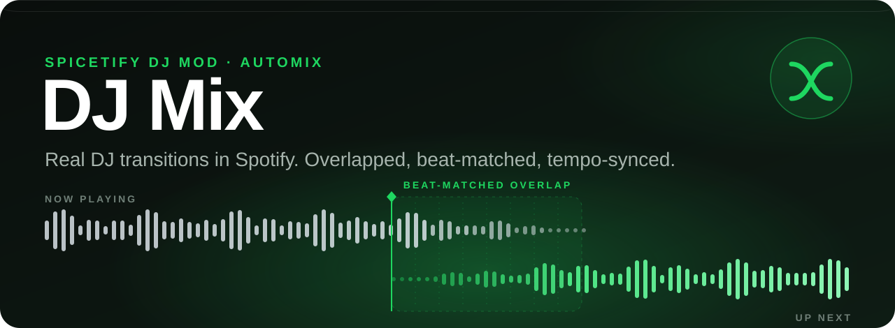
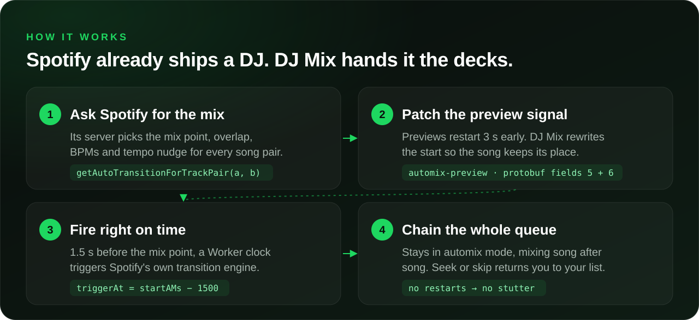

<p align="center">
  
</p>

<p align="center">
  <a href="#install"></a>
  <a href="https://github.com/ranveerthapar025-bit/spicetify-DJ-MOD-automix/releases/latest"></a>
  
  
  <a href="LICENSE"></a>
</p>

<h3 align="center">Your playlists, mixed like a DJ set.</h3>

<p align="center">
  The Spotify desktop app has a beat-matching transition engine hidden inside it.<br>
  <b>DJ Mix</b> switches it on for every song you play: the next track slides in on the beat,<br>
  its tempo locks to the one that's playing, and the two blend like a real DJ mix. No dead air. No cheap volume fade.
</p>

<p align="center">
  <a href="#install"><b>Install</b></a> &nbsp;·&nbsp;
  <a href="#using-it"><b>Using it</b></a> &nbsp;·&nbsp;
  <a href="#how-it-works"><b>How it works</b></a> &nbsp;·&nbsp;
  <a href="#troubleshooting"><b>Troubleshooting</b></a>
</p>

<br>

## Crossfade vs DJ Mix

|  | Spotify crossfade | **DJ Mix** |
| :-- | :-- | :-- |
| **When the next song starts** | A fixed number of seconds before the end, for every song | At the mix point Spotify's engine picks for that exact pair of songs |
| **Beats** | Two songs on top of each other, usually off-beat | Lined up bar for bar whenever the engine can beat-match the pair |
| **Tempo** | Untouched | The incoming song is sped up or slowed down a touch to lock in |
| **What you hear** | One song fading out while another fades in | An overlap that sounds like a DJ blend |

## Features

- 🎚️ **Beat-matched overlaps** — every transition comes from Spotify's own automix engine, the one built for its playlist Mix feature.
- 🥁 **Tempo sync** — the incoming song is nudged by a percent or two so the beats stay locked through the blend.
- 🔗 **Seamless chaining** — once the first mix fires, DJ Mix keeps mixing song after song without restarting playback, so there's no stutter between mixes.
- ⏭️ **Your controls still work** — seek, skip and back all work mid-mix and drop you back into your playlist at the right spot.
- 🪟 **Works when minimised** — timing runs on a background Worker clock, so mixes land on time even with Spotify in the tray.
- 🔔 **Mix notifications** — `🎧 Mixing into <song> · beat-matched (+1.6% tempo)`, if you want them.
- 🪶 **One file** — a single JavaScript file. No servers, no accounts, nothing talks to anything except Spotify.

## Install

**You need**

1. The **Spotify desktop app** from [spotify.com/download](https://www.spotify.com/download). The Microsoft Store version doesn't work with Spicetify.
2. **[Spicetify](https://spicetify.app/docs/getting-started)** installed and applied at least once.

### Easiest — Spicetify Marketplace

Open **Marketplace** in Spotify's sidebar, go to **Extensions**, search **DJ Mix** and click **Install**. Done.

<sub>No Marketplace yet? See the <a href="https://spicetify.app/docs/customization/marketplace">Spicetify Marketplace docs</a>, or use the one-paste install below.</sub>

### Quick install — Windows

Paste this into PowerShell:

```powershell
$dir = "$env:APPDATA\spicetify\Extensions"
New-Item -ItemType Directory -Force $dir | Out-Null
Invoke-WebRequest "https://github.com/ranveerthapar025-bit/spicetify-DJ-MOD-automix/releases/latest/download/djmix.js" -OutFile "$dir\djmix.js"
spicetify config extensions djmix.js
spicetify apply
```

Spotify restarts with DJ Mix running. That's it.

<details>
<summary><b>macOS / Linux</b> (untested so far)</summary>

<br>

```bash
mkdir -p ~/.config/spicetify/Extensions
curl -fsSL https://github.com/ranveerthapar025-bit/spicetify-DJ-MOD-automix/releases/latest/download/djmix.js \
  -o ~/.config/spicetify/Extensions/djmix.js
spicetify config extensions djmix.js
spicetify apply
```

Nothing in the code is Windows-specific, but it has only been tested on Windows. If your Spotify build lacks the automix engine, DJ Mix switches itself off instead of breaking anything.

</details>

<details>
<summary><b>From a clone</b> (for hacking on it)</summary>

<br>

```powershell
git clone https://github.com/ranveerthapar025-bit/spicetify-DJ-MOD-automix.git
cd spicetify-DJ-MOD-automix
powershell -ExecutionPolicy Bypass -File .\deploy.ps1
```

`deploy.ps1` copies `djmix.js` into Spicetify's Extensions folder, enables it if it isn't already, and runs `spicetify apply`. Run it again after every edit.

</details>

### Uninstall

```powershell
spicetify config extensions djmix.js-
spicetify apply
```

## Using it

Play any playlist or album and let it run. About 1.5 seconds before the mix point the next song starts blending in.

Click the **DJ Mix button** in the playbar to open the panel. It shows the next mix live: when it lands, how long the overlap is, both BPMs and the tempo change.

<p align="center">
  
</p>
<p align="center"><sub>Illustration. Song name and numbers are examples.</sub></p>

| Setting | Default | What it does |
| :-- | :-- | :-- |
| **Mix songs like a DJ** | On | Turns mixing on or off. The playbar button lights up while it's on. |
| **Show a notification on each mix** | On | Pops up the song that's mixing in and the tempo change. |

Settings are saved and survive restarts.

### What gets mixed

| When… | DJ Mix… |
| :-- | :-- |
| the next song comes from the playlist or album you're playing | **mixes it** |
| the next song is one you added to the queue | lets it play normally |
| repeat-one is on | stays out of the way |
| it's a podcast or audiobook episode | stays out of the way |
| Spotify has no transition for that pair of songs | changes song normally, right at the end |
| you seek, skip or go back mid-session | hands you back to your playlist at that spot and keeps mixing from there |
| you add songs to the queue while it's mixing | picks them up after your next seek or skip |

When a song isn't going to be mixed, the panel tells you why.

## How it works

<p align="center">
  
</p>

Spotify ships a native transition engine for its playlist **Mix** feature, but doesn't offer that feature on every account. The Mix editor can *preview* a transition between any two tracks, and that preview is played by the real audio engine. DJ Mix drives that preview path during normal listening.

<details>
<summary><b>The details</b></summary>

<br>

1. **Ask.** `Spicetify.Platform.PlaylistMixingAPI.getAutoTransitionForTrackPair(current, next)` returns Spotify's recipe for the pair: where the overlap starts in each song, how long it lasts in milliseconds and bars, both BPMs, whether it's beat-matched, and the playback speed for the incoming song.
2. **Patch.** The preview goes to the player as the signal `automix-preview` with a protobuf payload that says *start 3000 ms before the overlap*. DJ Mix rewrites field 5 (start position) to the song's current position and zeroes field 6 (the relative flag), so the outgoing song carries on from exactly where it is. If the payload ever changes shape, it's left untouched.
3. **Fire.** 1.5 s before the mix point, DJ Mix calls `playTransitionPreview`, with the editor's "pause first" and "stop the running preview" steps stubbed out so the music never stops. The clock runs in a Web Worker, because Spotify throttles normal timers to about once a second while it's minimised.
4. **Chain.** Going back to the normal player after each mix caused a ~270 ms stutter, so DJ Mix stays in automix mode and chains each next transition, following a snapshot of your up-next list (up to 150 songs). It hands control back to your real playlist only when you seek or skip, or at a song boundary when a pair has no transition. Spotify greys out seek and back in automix mode; DJ Mix keeps them working by routing them through that hand-back.

</details>

## Troubleshooting

<details>
<summary><b>There's no DJ Mix button, or nothing happens</b></summary>

<br>

- Run `spicetify config extensions`. `djmix.js` should be in the list. If it isn't, run the install again.
- Run `spicetify apply` to re-inject it.
- After a Spotify update, Spicetify needs `spicetify backup apply` (see the [Spicetify FAQ](https://spicetify.app/docs/faq)).

</details>

<details>
<summary><b>A song didn't mix</b></summary>

<br>

Open the DJ Mix panel. The status line says why, for example *Next song is from your queue, so it plays normally*, *Repeat-one is on*, or *Spotify has no transition for this pair*.

</details>

<details>
<summary><b>Seeing what it's doing</b></summary>

<br>

```powershell
spicetify enable-devtools
```

Then press <kbd>Ctrl</kbd>+<kbd>Shift</kbd>+<kbd>I</kbd> in Spotify and filter the console for `[DJ Mix]`. Every planned mix is logged with its recipe, and `__djmix.plan`, `__djmix.session` and `__djmix.settings` show the live state.

If the console says *This Spotify version has no automix engine; extension disabled*, your Spotify build doesn't include the engine. Updating Spotify and Spicetify is the only fix.

</details>

## Heads up

DJ Mix runs on undocumented parts of the Spotify app. Any Spotify update can change them. If the automix engine disappears, DJ Mix switches itself off and Spotify plays as normal; smaller changes could stop mixing until the extension is updated.

**Tested with** Spotify 1.3.9.2055 · Spicetify 2.46.7 · Windows 11.

## License

[MIT](LICENSE). Use it, fork it, remix it.

<sub>Not affiliated with or endorsed by Spotify. Spotify is a trademark of Spotify AB.</sub>
